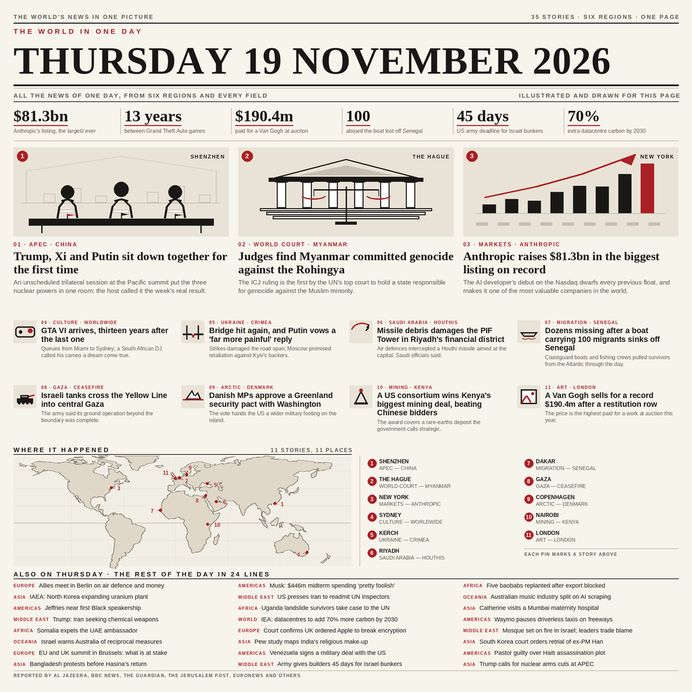

# The World Today — 19 November 2026

[](https://make.fun/bounty/news-image-20261119?utm_source=github&utm_medium=readme&utm_campaign=news-image-20261119)
[](https://make.fun/bounty/news-image-20261119/leaderboard?utm_source=github&utm_medium=readme&utm_campaign=news-image-20261119)
[](https://make.fun/bounty/news-image-20261119?utm_source=github&utm_medium=readme&utm_campaign=news-image-20261119)

One page, one day. Every story in this image happened, or was first published, on
**Thursday 19 November 2026**. The page holds **35 stories from six regions**: three
lead pictures with their own artwork, eight briefs with icons, a numbered world map,
and a 24-line index along the foot.



## What is on the page

| Band | What it carries |
|---|---|
| Masthead | The date, set as the largest thing on the page, above a strip of six figures |
| Leads (1–3) | The trilateral summit in China, the ICJ's genocide ruling, Anthropic's listing |
| Briefs (4–11) | GTA VI, the Crimea bridge, a missile over Riyadh, a boat off Senegal, Gaza, Greenland, a Kenyan mining deal, Van Gogh |
| Map | The eleven numbered stories pinned at the place each happened, keyed at the right |
| Index | 24 further stories from every region, one line each |

The three leads were chosen for consequence rather than novelty: a meeting of three
nuclear powers, a court naming a state guilty of genocide, and the largest listing in
market history. The briefs carry the day's other weight — a bridge, a missile, a boat,
a border — and the index catches the rest, from a retrial in Seoul to a vaccine death
in Pennsylvania.

## How it is built

```
tools/render.py        draws the page (Pillow, authoring time only)
tools/content.py       the day's stories as data: kickers, headlines, decks, pins
tools/gen_sources.py   writes SOURCES.md from the feed harvest, refuses to invent
tools/data/land.json   simplified coastlines for the map (Natural Earth, public domain)
main.py                build step: verifies entry.png and places it in output/
```

`main.py` is pure standard library. It parses the PNG's chunks, checks the image is
1024×1024 RGB, walks the IDAT stream to confirm the deflate data ends exactly where
the file says it does, and copies the page to `output/entry.png`. Two runs produce
byte-identical output:

```sh
python3 main.py          # no dependencies
```

Redrawing the page needs Pillow, which is only ever needed at authoring time:

```sh
python3 -m venv .venv && .venv/bin/pip install pillow
.venv/bin/python tools/render.py
```

## Layout is checked, not eyeballed

`tools/render.py` keeps a record of every text run it draws — its box, its measured
width, its size — and then checks that record before saving:

- nothing sits outside the page margins;
- no text run is wider than the cell it was given;
- no two cards overlap;
- no line falls below the smallest size used anywhere on the page.

The render is also reviewed as a 300-pixel thumbnail, because that is the size at
which this kind of page is first judged, and every headline has to survive it.

## Artwork

Every picture is drawn in code: a summit table under a hall arch, a court facade with
its portico and scales, a listing chart, eight small icons, and the world map. The map
is an equirectangular projection of the Natural Earth land layer, and its pins are
placed from real coordinates and hand-labelled so the crowded European cluster stays
readable. No photographs, stock images or third-party illustrations appear anywhere
on the page.

## Sources

`SOURCES.md` lists all 35 stories with the outlet, the headline as published, and a
link to the item. It is generated from the day's feed harvest by `tools/gen_sources.py`,
which fails if a line on the page cannot be matched to exactly one published item.

## Licence

MIT.

## The bounty

This page is an entry in make.fun's ["Sum up 19 November's world news in one image"](https://make.fun/bounty/news-image-20261119) bounty.
